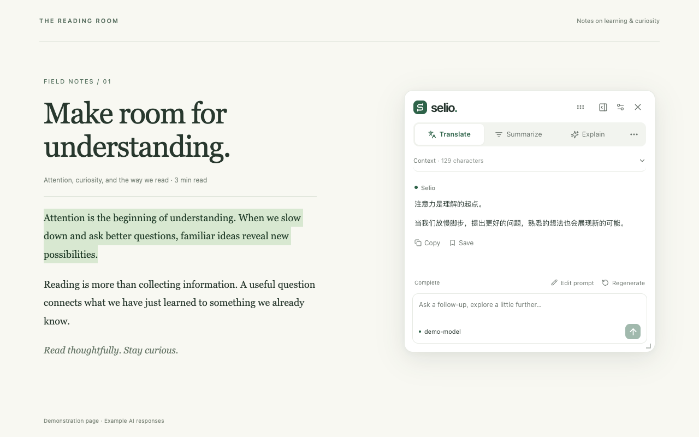
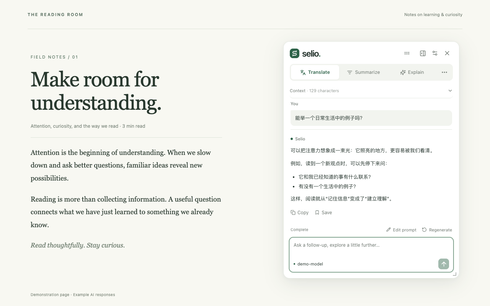
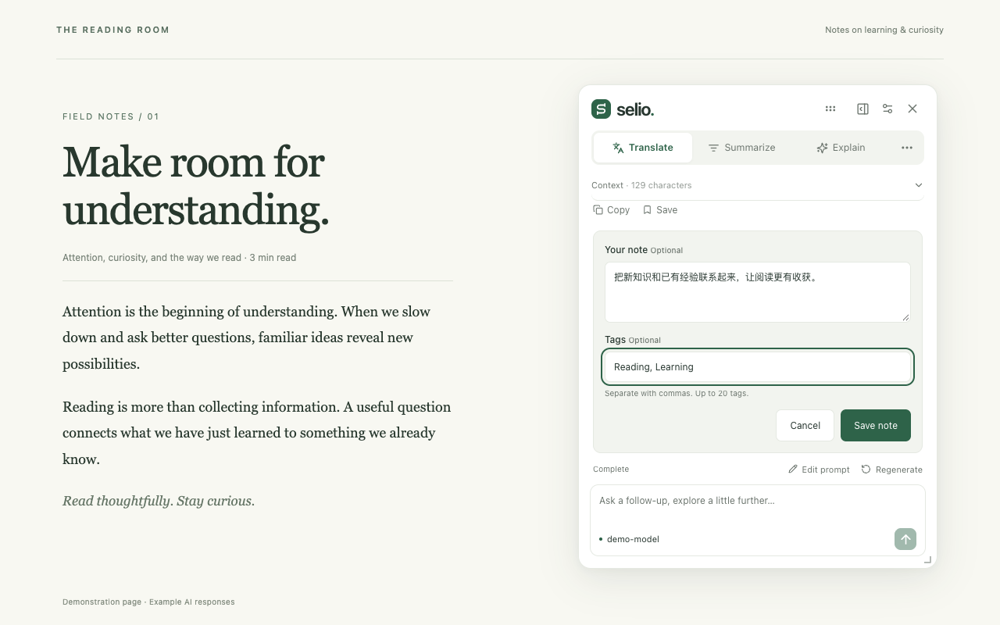

<p align="center">
  
</p>

<h1 align="center">Selio</h1>

<p align="center"><strong>Select. Understand. Explore.</strong></p>

Selio 是一个面向 Chrome 的 AI 阅读助手。选中文字即可翻译、总结或解释，也可以在侧边栏针对当前网页提问，在阅读过程中继续探索。

使用自己的模型与 API Key，直接连接所选供应商，无需 Selio 账户或独立后端。

## ✨ 功能

- **划词阅读**：翻译、总结、解释与自由提问，支持多轮追问、停止生成、重新生成和复制回答。
- **网页问答**：在本机提取当前页面正文，按问题选择相关片段，并提供可展开核对的原文范围。
- **浮窗与侧边栏**：浮窗支持拖动和缩放，可将对话接续到 Chrome 原生侧边栏；每个标签页独立保存会话。
- **自定义操作**：编辑 Prompt、指定模型、调整顺序，或在执行前修改本次指令。
- **收藏笔记**：保存选中文字与 AI 回答，添加备注和标签，支持搜索、网站筛选和 Markdown 导出。
- **多模型配置**：支持 OpenAI-compatible 与 Anthropic 原生协议，可在对话中切换模型。
- **用量统计**：查看供应商返回的 Token 用量，按日期和供应商筛选请求记录。
- **阅读偏好**：英文与简体中文界面，浅色、深色和系统主题，以及自动划词和网站开关。



*划词翻译示例。本文截图使用演示页面与示例回答。*

## 🚀 安装与启动

需要 Chrome 116+。从源码构建需要 Node.js 22.12+ 与 pnpm 10，包管理器版本由 `package.json` 指定。

### 从源码安装

在项目目录执行：

```bash
pnpm install
pnpm build
```

1. 打开 `chrome://extensions`，开启「开发者模式」。
2. 点击「加载已解压的扩展程序」，选择 `.output/chrome-mv3`。
3. 将 Selio 固定到浏览器工具栏，点击图标打开侧边栏，再点击 **Open settings** 配置模型。

界面默认使用英文，可在设置页右上角切换为简体中文。默认翻译目标语言为简体中文，与界面语言独立。

### 开发模式

```bash
pnpm dev
```

保持开发服务器运行，在 Chrome 中加载 `.output/chrome-mv3-dev`。此项目需要手动加载扩展，开发服务器不会自动启动浏览器。

### 打包

```bash
pnpm zip
```

ZIP 文件生成在 `.output` 中。通过「加载已解压的扩展程序」安装时，先解压，再选择包含 `manifest.json` 的目录。

## 🔌 模型配置

在设置的「模型」页面选择供应商，填写 **Base URL**、**模型标识** 和 **API Key**，保存后即可使用。「测试连接」会发送一个简短请求，可能产生 API 用量。

| 供应商 | 接入协议 |
| --- | --- |
| OpenAI | Chat Completions |
| Anthropic | 原生 Messages API |
| Gemini、Qwen、Kimi、DeepSeek | OpenAI-compatible Chat Completions |
| Custom | 自定义 OpenAI-compatible 接口 |

内置预设可编辑，模型标识与 API 地址应以供应商及账户实际支持的配置为准。Qwen、Kimi 预设使用国际站地址，中国大陆账户需修改为对应区域的接口，密钥也需匹配区域。

- Base URL 使用 HTTPS；本地服务允许 `http://localhost`、`http://127.0.0.1` 和 `http://[::1]`。
- Anthropic 自动补全 `/messages`，其他供应商自动补全 `/chat/completions`，也可填写完整接口地址。
- 支持 SSE 流式输出。仅支持 Responses 或其他未适配协议的接口暂不可用。
- 默认模型用于新对话，已有对话可通过输入框旁的模型菜单切换。

## 📖 使用

### 划词理解

在普通网页选中文字，点击选区旁的 Selio 图标，或悬停约 0.8 秒，执行默认操作。也可通过右键菜单「用 Selio 理解选中文字」打开侧边栏。

划词模式默认只发送选中文字。需要周围语境时，可在上下文中选择「选中文字 + 所在段落」。输入问题继续追问，`Enter` 发送，`Shift + Enter` 换行。

点击浮窗的固定按钮可接续到侧边栏。切换操作或发送范围时，会恢复该组合已有的回答与草稿；切换到新选区会开始新的划词对话。

自动划词默认在普通 HTTP/HTTPS 网页开启。可在「隐私与权限」中关闭全站模式、仅启用指定网站，或禁用个别网站。



*围绕选中文字继续追问，无需离开原网页。*

### 针对网页提问

点击工具栏图标打开侧边栏，Selio 会在本机提取当前页面正文；发送问题后才调用模型。已有划词对话时会先接续原会话，可主动开启「使用当前页面」进入网页问答。

- 展开「页面内容」查看提取正文及回答使用的片段。
- 页面导航或正文变化后，使用「刷新正文并开始新对话」重新提取。
- 关闭「使用当前页面」可开始普通 AI 对话，不发送网页正文、标题或 URL。

短文可完整提供给模型；长文使用本地关键词检索选择片段，概括类问题使用首尾和中间抽样。**长文抽样概览不等同于完整全文总结。** 每次请求的正文预算为 16,000 字符，本地最多保留 180,000 字符，超过上限会提示截断。

### 自定义 Prompt

在「操作与 Prompt」中创建或编辑操作，可指定模型，选择直接执行或先编辑再执行。第一个已启用操作为默认操作，前 3 个显示在快捷标签中，其余位于「更多操作」。

Prompt 必须包含 `{{selection}}`，可使用 `{{language}}` 引用目标语言。例如：

```text
请用 {{language}} 解释以下内容中的关键概念，并给出一个简短例子。

内容：{{selection}}
```

将 **Ask AI / 询问 AI** 设为默认操作时，只会打开对话，发送问题后才请求模型。

### 收藏与用量

回答下方的「收藏」可保存原始选区、来源页面、AI 回答、备注和标签。在侧边栏的「收藏笔记」中搜索、编辑或导出 Markdown；这些操作不调用模型。



*将回答保存为笔记，并添加自己的理解与标签。*

「Token 用量」显示最近 1,000 次请求的供应商计数，不估算费用。缺失用量显示为 `—`，取消或失败的请求仍可能产生实际消耗，统计不能代替供应商账单。

## 🔒 数据与隐私

请求由扩展后台直接发送给用户配置的模型供应商，没有 Selio 中转服务器，不包含第三方分析或追踪 SDK。

| 数据 | 处理方式 |
| --- | --- |
| 模型配置、偏好、收藏笔记、用量记录 | 保存在本机，不使用 `storage.sync` |
| API Key | 默认持久保存在本机扩展存储中，**未加密**；可改为仅本次浏览器会话保存 |
| 临时对话 | 保存在浏览器会话存储中；关闭标签页后清除，不提供长期对话历史 |
| 划词请求 | 发送选中文字、可选段落及保留的问答，不发送网页标题或 URL |
| 网页问答 | 发送页面标题、选中的正文片段、范围信息及保留的问答；完整 URL 仅用于本地来源与导航检查 |

API Key 仅由扩展后台读取使用，网页和内容脚本不能直接读取密钥。选择会话保存时，关闭浏览器、停用、重载或更新扩展后需重新输入。

安装时会申请普通 HTTP/HTTPS 网页的访问权限，用于划词、正文提取和连接模型接口。选中文字、打开侧边栏或刷新正文本身不会调用模型；点击或悬停选区图标执行操作、发送问题、重试及测试连接等操作才会发起请求。关闭自动划词可限制监听范围，也可在 Chrome 扩展设置中调整网站访问权限。

不读取浏览历史，不自动上传整页 DOM、表单输入或图片。模型处理已发送内容的方式取决于所选供应商的政策。完整说明见[隐私政策](index.html)。

## 🛠️ 开发与贡献

技术栈：**WXT · React · TypeScript · Floating UI · Mozilla Readability**，基于 Chrome Manifest V3。

```text
entrypoints/        后台、内容脚本、设置页与侧边栏入口
src/
  background/       配置存储、会话管理、收藏与用量
  components/       共享聊天与设置组件
  hooks/            会话连接、主题与浮窗交互
  llm/              模型适配、Prompt 与 SSE 解析
  page/             正文提取、分片与本地检索
  shared/           类型、校验、供应商预设与国际化
smoke/              浏览器端到端测试
tests/              单元测试
```

后台统一管理会话与请求状态，浮窗和侧边栏共享同一对话。生成中断后不会自动重发请求。

### 验证

```bash
pnpm typecheck
pnpm lint
pnpm test
pnpm build
```

浏览器端到端测试：

```bash
pnpm exec playwright install chromium
pnpm test:smoke
```

测试使用本地 Mock API 与临时 Chromium profile，无需真实 API Key。已有 Chromium 时，可通过 `SELIO_CHROMIUM_PATH` 指定可执行文件。截图与 trace 输出到 `test-results/`。

欢迎通过 Issue 报告问题或讨论功能，也欢迎提交 Pull Request。问题反馈请附上复现步骤、Chrome 版本、扩展版本和经过脱敏的错误信息；涉及模型兼容性时注明供应商与模型标识。代码变更请补充相关测试，并运行上述检查。

## 📌 当前限制

- 面向 Chrome MV3，暂未适配 Firefox 或 Safari。
- Chrome 内部页面、Chrome Web Store、内置 PDF 阅读器等限制注入的页面不支持划词浮窗。
- 只处理顶层网页中已加载的文本，不读取 iframe、Shadow DOM、表单、Canvas、图片或 PDF，不自动滚动或绕过登录、付费墙。
- 正文提取使用启发式规则，特殊排版可能提取不完整；动态内容变化后需手动刷新正文。
- 尚未提供完整长文分层总结、向量检索、截图/OCR、长期记忆或云同步。
- 模型兼容性测试使用本地 Mock API，真实账户的模型权限、服务可用性和计费需以供应商为准。
